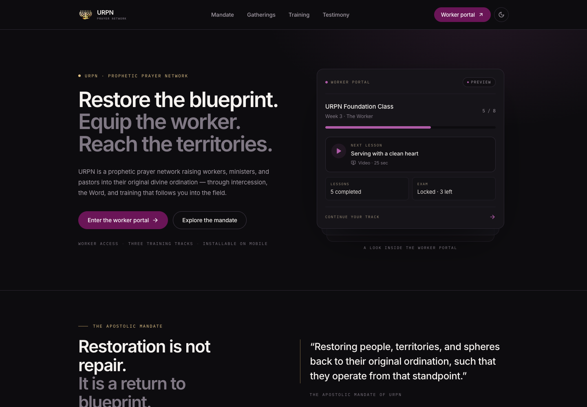
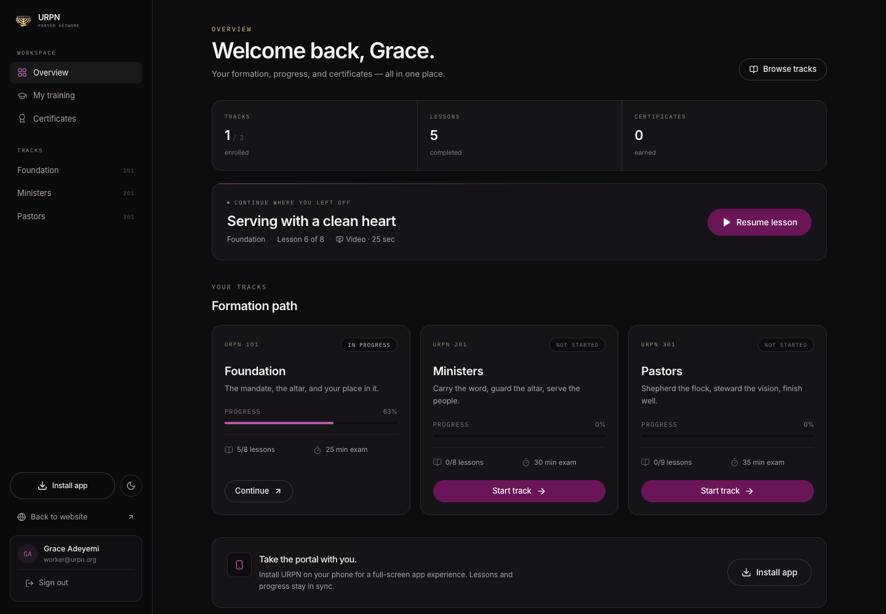
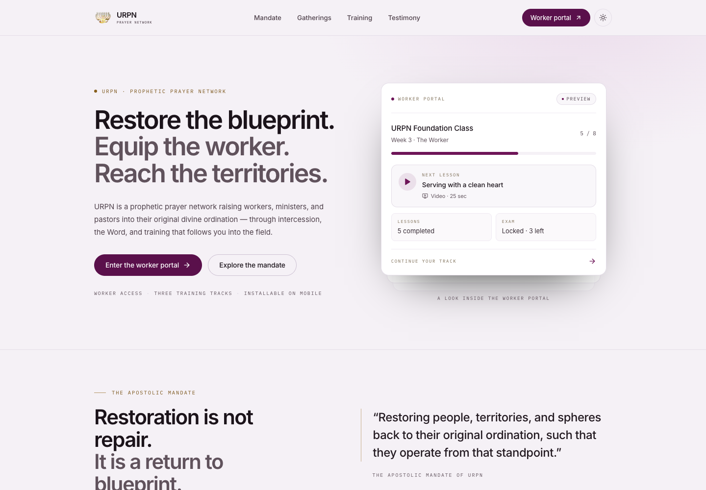
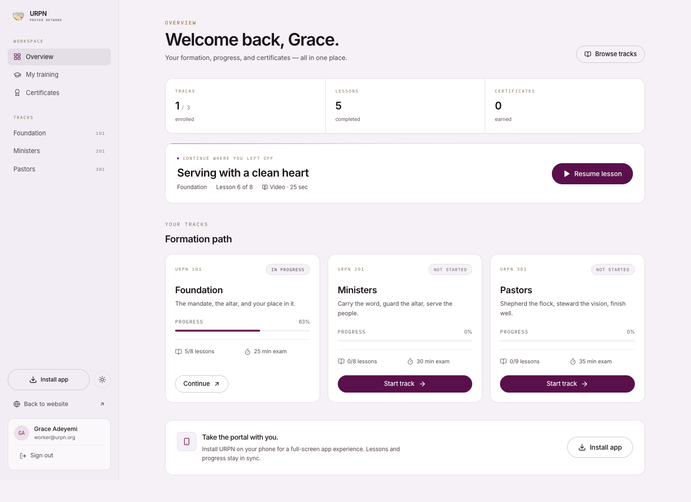

# URPN — Unique Revival Prayer Network

A complete redesign of the URPN website plus an authenticated **worker training portal** with three tracks, streamed lessons, progress tracking, a timed one-attempt exam, and verifiable certificates. The existing testimony recording flow is included and restyled to match.

Built with **Next.js 14 (App Router)**, React 18, TypeScript, and Tailwind CSS. No external database or SaaS is required for local use.

---

## Preview

Dark (default):




Light:




Installation: [install page](docs/screenshots/install-light.png) · [mobile install guide](docs/screenshots/install-mobile-light.png)

More: [mobile home](docs/screenshots/home-mobile.png) · [mobile dashboard](docs/screenshots/portal-dashboard-mobile.png) · [lesson player](docs/screenshots/lesson-player.png) · [course overview](docs/screenshots/course-overview.png)

---

## What is included

### Public site
- Charcoal, dark magenta, and gold design system (flat surfaces, magenta actions, gold editorial accents, restrained typography).
- Responsive marketing homepage: hero, mandate, vision/mission, training tracks, gatherings, gallery, testimony CTA.
- Calendar downloads (`.ics` / Google Calendar) and RSVP flow for gatherings.
- Testimony page with voice, video, and written submissions (existing Google Drive/Sheets integration preserved).
- Light and dark themes with a persisted toggle in the header, login page, and portal.
- Dedicated `/install` page plus an installable PWA with offline fallback.

### Worker portal (`/portal`)
- Email + password accounts with scrypt hashing, signed HTTP-only sessions, and login rate limiting.
- Three training tracks:
  1. **URPN Foundation Class** (`/portal/courses/foundation`)
  2. **URPN Ministers Training** (`/portal/courses/ministers`)
  3. **URPN Pastors Training** (`/portal/courses/pastors`)
- Same format in every track: video, audio, and reading lessons; progress saved across devices; no loose downloads.
- Private media streaming through `/api/portal/stream/[lessonId]` with enrollment checks and HTTP range support.
- Lesson completion at 90% of the authoritative media duration (readings are marked complete explicitly).
- Final exam unlocks only when every lesson is complete.
- Exam rules: one attempt, server-authoritative timer, auto-submit when the tab is hidden, 60-second network grace, instant score.
- Certificate issued automatically on passing, with a unique code and a public verification page.
- Certificate print view designed for **A4 landscape** → “Print / Save as PDF”.
- PWA install prompt on desktop/Android, iOS “Add to Home Screen” instructions, an install guide, and a theme-aware offline page.

### Route map

| Route | Purpose |
| --- | --- |
| `/` | Marketing site |
| `/testimony` | Voice / video / written testimony |
| `/portal/login` | Worker sign in and registration |
| `/portal` | Worker dashboard |
| `/portal/courses` | All three tracks |
| `/portal/courses/[slug]` | Course overview + curriculum + exam state |
| `/portal/courses/[slug]/lessons/[lessonId]` | Streamed lesson player / reading |
| `/portal/courses/[slug]/exam` | Exam rules, then the timed exam |
| `/portal/courses/[slug]/exam/result/[attemptId]` | Score, review, certificate link |
| `/portal/certificates` | Earned certificates |
| `/portal/certificates/[code]` | Printable certificate |
| `/verify` | Public certificate lookup |
| `/verify/[code]` | Public verification result |
| `/install` | Install guide for iOS, Android, and desktop |
| `/offline.html` | Static, theme-aware PWA offline fallback |

---

## Quick start

```bash
npm install
npm run dev
```

Open [http://localhost:3000](http://localhost:3000).

### Demo worker

On a fresh database, the app seeds one demo worker when `SHOW_DEMO_LOGIN` is not `false`:

```text
Email:    worker@urpn.org
Password: urpn2026
```

The demo account starts with 5 of 8 Foundation lessons complete, so you can try the player, the progress tracking, and the last three lessons before sitting the exam.

**Before going public**, set `SHOW_DEMO_LOGIN=false`, remove the local `data/` directory, and register real accounts (or add your own invitation flow). The demo password is intentionally simple.

### Reset local data

```bash
rm -rf data
```

The next request reseeds the database. Session cookies become invalid, which is expected.

---

## Exam behavior

- Questions and answer keys live only on the server (`lib/exam-bank.ts`); the browser receives prompts and options without the correct answer.
- Starting an exam creates a server-side attempt with an `expiresAt` timestamp. The client countdown is display only; the server enforces the deadline.
- **Leaving the tab** (visibility change) or closing the page submits the attempt automatically. It cannot be resumed afterwards.
- Closing the whole browser without sending the submission leaves the attempt open until its deadline; the server marks it expired when it is next accessed. This is a deliberate network-failure recovery path, not a second attempt.
- Only one attempt per user per course is ever created. A second start returns `409 already_attempted`.
- A late submission (more than 60 seconds past the deadline) is recorded as expired and cannot pass.
- Scores: Foundation 70% to pass, Ministers 75%, Pastors 80%. Exams are 25/30/35 minutes with 12 questions each.
- The result page shows each question, the chosen option, the correct option, and an explanation.

---

## Replacing the demo lessons with your own teaching

The demo videos are short narrated placeholders generated on macOS. Replace them without touching the player:

1. Export video as **H.264 / AAC MP4** (max compatibility) or audio as **M4A/AAC**.
2. Put the file in the private **`media/`** directory. Do **not** put it in `public/` — public files bypass authentication.
3. Update the lesson in **`lib/courses.ts`**:
   ```ts
   media: {
     file: 'foundation-welcome.mp4',   // name inside media/
     mime: 'video/mp4',
     durationSeconds: 612,             // exact duration; drives 90% completion
     poster: '/posters/foundation-welcome.jpg',
   }
   ```
4. Put the poster image in `public/posters/` (a still frame is fine).
5. Keep lesson IDs stable once workers have progress. To add a lesson, add it to a module; to change an exam, edit `lib/exam-bank.ts` and update `course.exam.questionCount`.

Media is served only through `/api/portal/stream/[lessonId]?course=[slug]`, which checks the session and enrollment, supports `Range` requests for seeking, and sends `Content-Disposition: inline` with `no-store`. The player also disables download controls, picture-in-picture, and the context menu. No system can prevent screen recording; this is access-controlled streaming, not DRM.

### Regenerating the demo assets (optional)

```bash
python3 scripts/generate-brand-assets.py
python3 scripts/generate-demo-media.py    # macOS `say` + ffmpeg
```

`generate-demo-media.py` also updates the `durationSeconds` values in `lib/courses.ts` to match the generated files.

---

## Accounts, sessions, and data

- Passwords: scrypt with a per-user salt; hashes never leave the server.
- Sessions: HMAC-SHA256 signed token in an HTTP-only, SameSite=Lax cookie (30 days). Set `AUTH_SECRET` in production so sessions survive restarts and multiple instances.
- Login and registration are rate-limited in memory. Use a shared limiter if you run multiple instances.
- Registration is open by default. If the portal should be invite-only, gate `/api/auth/register` with an invite code or remove the “Create an account” link.
- `middleware.ts` preserves the intended course/lesson URL through sign-in (`/portal/login?next=...`), so marketing course links land in the right place after login.
- Data lives in a small JSON store at `data/urpn-db.json` (override with `URPN_DATA_DIR`). Writes are serialized and committed atomically. All persistence goes through `lib/server/db.ts`, so replacing it with Postgres, SQLite, or Vercel KV only requires changing that module.

### Production persistence

`data/` is git-ignored. On a VPS or any host with a persistent writable volume, set `URPN_DATA_DIR` to that volume and the app is fully functional.

### Researched production architecture

The current JSON store is intentionally a prototype. The researched production design is documented in [docs/INFRASTRUCTURE.md](docs/INFRASTRUCTURE.md), with a ready-to-apply Supabase schema in [supabase/migrations/0001_initial.sql](supabase/migrations/0001_initial.sql).

Short version:

- **Database/Auth:** Supabase Postgres (Pro) with Supabase Auth and RLS, EU region for Nigeria (no African Supabase region).
- **Video:** Mux (recommended) or Cloudflare Stream/Bunny Stream. Do **not** stream lesson media from Google Drive or Telegram.
- **Google Drive:** keep it as the upload/archive source for a sync job that publishes to Mux/Stream.
- **Telegram:** announcements/reminders only — the Bot API has a 20 MB file-download limit and is not a video CDN.
- Approximate cost at 25 lessons and 100–500 workers: **$25–30/month** with Supabase Pro + Mux.

**Vercel/serverless caveat:** the filesystem is ephemeral. Without a persistent volume or an external database, accounts, progress, and certificates reset between deployments/instances. The media files themselves are read-only and are traced into the serverless bundle (`next.config.mjs`), but the portal database is not. For a public deployment, replace the JSON adapter in `lib/server/db.ts` with a real database (Postgres via `pg`/Prisma, Upstash Redis, etc.) before onboarding workers.

---

## Light and dark mode

The site defaults to the dark charcoal theme. A sun/moon toggle appears in the public header, the sign-in page, and the portal (sidebar on desktop, top bar on mobile). The choice is stored in `localStorage` under `urpn-theme` and applied by an inline root-layout script before paint, so there is no flash. It also updates the browser `theme-color`.

| | Dark (default) | Light |
| --- | --- | --- |
| Canvas | `#0D0C0F` | `#F5F1F6` |
| Surface | `#161419` | `#FFFFFF` |
| Primary action | `#6A1557` | `#5A104B` |
| Accent / progress | `#B05BA8` | `#6E1558` |
| Gold | `#D8B56F` | `#8A6423` |

All Tailwind semantic colors (`canvas`, `surface`, `line`, `cream`, `ink`, `accent`, `gold`) are CSS variables, so both themes flow through every page, form, exam, and the certificate print view. The static offline shell also reads the saved theme.

---

## PWA / installability

- Manifest: `public/manifest.webmanifest` (name, short name, standalone display, theme, icons, shortcuts).
- Icons: `public/icons/` (192, 512, maskable 512, Apple touch, favicon).
- Service worker: `public/sw.js` — precaches the offline page and static assets, uses network-first for public pages, and **never caches API responses, media streams, or authenticated portal pages**.
- Registration happens only in production (`components/PwaRegister.tsx`), so development is never served from a stale cache.
- Install UI: `components/InstallAppButton.tsx` (Chrome/Android prompt + iOS instructions). It appears in the footer, dashboard, portal sidebar, and the dedicated `/install` page.
- Installation is a **PWA install**, not an App Store / Play Store download. For a native APK/IPA later, wrap this PWA with Capacitor; nothing here prevents that.

To test installability locally:

```bash
npm run build
npm start
```

Open `http://localhost:3000` in Chrome (localhost is treated as a secure origin).

---

## Configuration

Copy `.env.example` to `.env.local` and set what you need.

| Variable | Required | Purpose |
| --- | --- | --- |
| `AUTH_SECRET` | Production | 32+ random chars for session signing |
| `URPN_DATA_DIR` | Production with persistent disk | Writable directory for the portal JSON store |
| `SHOW_DEMO_LOGIN` | No | Set `false` to hide/disable the demo seed account |
| Google Drive/Sheets + Deepgram variables | Testimony only | See `.env.example` and `OAUTH-SETUP.md` |

The public site and portal run without Google or Deepgram keys. The testimony page records locally and falls back to mock transcription/storage when those services are not configured.

---

## Testimony module (existing functionality)

Submissions can be voice (up to 10 minutes), video (up to 7 minutes), or written. Recordings upload to Google Drive, are transcribed by Deepgram (Google Speech fallback), and are logged to a Google Sheet. Setup instructions are in [`.env.example`](.env.example) and [`OAUTH-SETUP.md`](OAUTH-SETUP.md).

If no credentials are present, the API returns a mock success path for local development. Do not rely on that in production.

---

## Scripts

```bash
npm run dev       # development server
npm run build     # production build
npm start         # production server
npm test          # vitest (23 tests)
npm run lint      # next lint (if configured)
```

Additional generators:

```bash
python3 scripts/generate-brand-assets.py   # emblem crop + PWA icons
python3 scripts/generate-demo-media.py     # demo videos/audio/posters
```

---

## Design notes

- Canvas `#0D0C0F`, surface `#161419`, line `#2B2631` in dark mode; canvas `#F5F1F6`, surface `#FFFFFF`, line `#E4DDE8` in light mode.
- Deep plum-magenta `#6A1557` for primary buttons; orchid-violet `#B05BA8` for links, focus, progress, and active states.
- Gold `#D8B56F` for eyebrow labels, editorial rules, completed lessons, exam passes, and certificates; gold deepens to `#8A6423` in light mode so small labels stay legible.
- Inter for interface text, IBM Plex Mono for labels and codes.
- Warm charcoal with a slight magenta undertone, flat cards, 1px borders, 12–16px radii, no decorative gradients or glow text.
- Mobile-first: portal bottom tab bar, collapsible curriculum, stacked player, install guide, and a responsive theme toggle. Audited at 320, 360, 390, 768, 1024, and 1440 px in **both themes** with zero horizontal overflow.
- Light mode is a true palette swap (variables), not an inverted filter; images, video, the certificate, and the live camera preview keep their intended contrast.
- Certificate uses a cream/brass print palette, Georgia for the recipient name, and A4 landscape print CSS.

---

## Security checklist before launch

- [ ] Set a strong `AUTH_SECRET`.
- [ ] Set `SHOW_DEMO_LOGIN=false` and remove `data/`.
- [ ] Move persistence to a durable database/volume.
- [ ] Decide whether registration is open or invite-only.
- [ ] Replace demo media with your own teaching.
- [ ] Configure Google/Deepgram if the testimony module is public.
- [ ] Review certificate revocation/reissue policy (not included).
- [ ] Add a privacy policy for worker data and testimony content.

---

## License

Private project for URPN. All teaching media and branding belong to Unique Revival Prayer Network.
